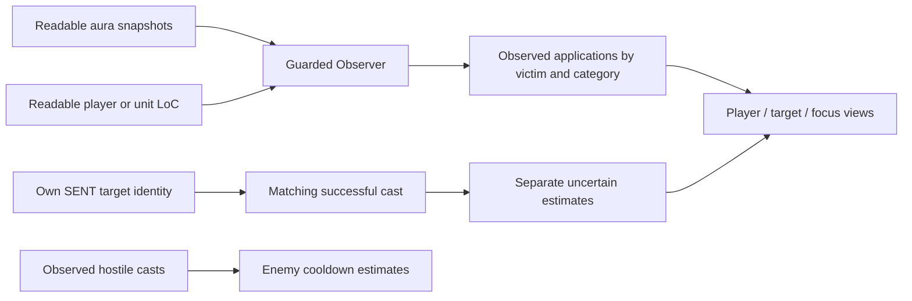

# bjarkiCC architecture and DR research

Research checked 2026-10-17. This document separates source evidence, addon policy, reported behavior and offline validation.

## Findings that matter for this bug

The DR **stage** can change as soon as a CC application is observed. That does not make the application's time the start of the later **reset window**. Diminish supports displaying a category immediately on application, but its implementation extends the expiration to the aura's end plus the reset interval and updates the expiration when the aura ends. Its application display option therefore does not implement a duration-independent, application-only reset clock. [Diminish timer implementation, pinned source](https://github.com/wardz/Diminish/blob/eef7b235c53194e62da8e996ee41f2c5acf3a883/Diminish/core/timers.lua)

The DRList author's simpler example starts/updates a timer on aura removal or refresh. This is a usage example, not a complete specification for overlapping effects or all refresh edge cases. [Author's example, edited 2025-05-25](https://github.com/wardz/DRList-1.0/wiki/Example-Usage)

The user's requested application-only timer is a legitimate addon display policy to preserve, but the repository must label it as an estimate chosen for this addon, rather than claim research proves it is the Classic/Forever server reset rule. Showing an icon immediately and knowing the server's exact reset deadline are separate requirements.

## Classic Era baseline

The inspected DRList Classic profile represents successive CC durations as full, half, quarter, then immune. After observing the first successful application, a next-application indicator therefore reads 50%; after the second, 25%; after the third, immune. Its Classic reset interval is 20 seconds, explicitly a conservative maximum for a dynamic 15–20-second reset. This does not establish a fixed 20-second server timer, nor an 18-second Classic rule. The profile's ordinary-NPC categories are controlled stun and Kidney Shot; player rules should not be applied indiscriminately to every creature. Its automatic unknown-project fallback selects MoP, so Forever must select a deliberate profile rather than inherit that fallback. [DRList core, revision 82](https://github.com/wardz/DRList-1.0/blob/05c3c794fc18791d2173ea5361a6aa9c0029d91f/DRList-1.0/DRList-1.0.lua)

The following are selected mappings from its **Classic** spell table, not the Retail table:

| Category | Examples |
| --- | --- |
| Controlled stun | Hammer of Justice, Cheap Shot, Bash, Pounce, Charge stun, Intercept stun, War Stomp |
| Random stun | Mace stun, Blackout, Impact, Seal of Justice stun |
| Kidney Shot | Kidney Shot |
| Incapacitate | Polymorph, Sap, Gouge, Freezing Trap effect, Scatter Shot, Hibernate, Repentance |
| Fear | Fear, Psychic Scream, Howl of Terror, Seduction, Intimidating Shout |
| Controlled root | Entangling Roots, Nature's Grasp, Frost Nova, Counterattack |
| Random root | Improved Wing Clip, Improved Hamstring |
| Mind control | Mind Control, Gnomish Mind Control Cap |
| Frost Shock | Frost Shock |

Thus Kidney Shot is separate from HoJ/Cheap Shot; random stuns and roots are separate from their controlled counterparts. The source combines Era and Season of Discovery entries, explicitly marking SoD additions. Copying the entire table would silently import those additions. Blind, Death Coil, and silence/disarm categories are not entries in this inspected Classic table; absence alone is not proof of their Forever behavior. [DRList spell table](https://github.com/wardz/DRList-1.0/blob/05c3c794fc18791d2173ea5361a6aa9c0029d91f/DRList-1.0/Spells.lua)

## Forever evidence and uncertainty

Blizzard's beta development notes through the update titled October 15 and its known-issues topic updated October 8 were searched for DR rules. Neither reviewed page specifies a CC DR reset clock or a complete category mapping. That is a bounded finding about these pages, not proof Blizzard has never documented it elsewhere. The development notes do establish changing class tuning: the October 15 update changes War Stomp's cooldown to 90 seconds from 120. Cooldown tuning and DR rules must be versioned separately. [Blizzard development notes](https://us.forums.blizzard.com/en/wow/t/wow-forever-beta-development-notes-%E2%80%93-updated-october-15/2360696/6), [Blizzard known issues](https://us.forums.blizzard.com/en/wow/t/wow-forever-beta-known-issues-october-8/2352687)

A newly published Forever-specific addon provides a useful independent maintainer report: DRTrackerForever targets 1.60.1, reports hidden combat logs/enemy auras and a disabled native DR system, and supplements visible auras with player/group casts. Its README uses 18 seconds after the last CC ends. This is an implementation assumption/maintainer report, **not Blizzard confirmation** of that number. Its code comments specifically report `C_SpellDiminish.IsSystemSupported()` returning false and use `UNIT_SPELLCAST_SENT`, `UNIT_SPELLCAST_SUCCEEDED`, `UNIT_COMBAT`, readable aura APIs, and player loss-of-control data. [Maintainer README](https://github.com/Pirson-s-Addons/DRTrackerForever/blob/231dbfd544e3248db2bcb5445a96db272a503d87/README.md), [source adapter](https://github.com/Pirson-s-Addons/DRTrackerForever/blob/231dbfd544e3248db2bcb5445a96db272a503d87/Core/Sources.lua)

The report is consistent with the user's symptom: player CC can be observable through player loss-of-control data while outgoing CC on a target is unavailable to an aura-only observer. It does not prove the exact cause of this user's missing target icon. That requires the current observer path and runtime diagnostics.

## Recommended architecture boundaries

These are design recommendations derived from the above limitations, not additional claims about Blizzard internals:

1. Maintain one state per victim GUID and category. Player, target and focus are views of that state, so self-targeting or sharing a target and focus cannot count the same application twice.
2. Keep cast/cooldown observation separate from CC application evidence. A successful cast event does not prove an effect landed: resistance, immunity, travel, crowd-control target changes, ground traps and area effects can intervene.
3. Record the evidence source on each observation: readable aura, player LoC, inferred own cast, or unknown. An inferred cast may start an estimated display immediately; it must not be promoted silently to a confirmed application.
4. Capture a readable intended target at cast-send time where available and correlate it with the cast identifier. Do not assign a delayed successful cast to whichever target happens to be selected later. Skip ambiguous or secret identities; do not guess an area spell's victims.
5. Deduplicate an inferred own cast against its later readable aura. Update the same application rather than advancing the stage twice. Aura instance IDs are stronger evidence than matching a spell name in a short time window.
6. Do not advance confirmed DR on an immune/resisted attempt that produced no observed application. A generic miss event without spell/cast attribution is not enough to undo one exact record. A break/removal ends an observed effect; it should not erase the fact that it was applied.
7. An aura refresh may represent another application, but an unchanged repeated snapshot does not. Do not infer a new stage merely from polling; require a new instance or reliable refresh evidence, otherwise expose uncertainty.
8. Store stage progression, active-effect coverage, and timer policy independently. For the current application-only policy, removal must not restart the displayed timer. If a researched removal-based policy is added later, it must be an explicit setting/migration with tests rather than a silent semantic change.
9. Keep Classic-derived spell groups provisional on Forever. Do not import Retail's current categories, changing reset times, or immunity thresholds, and do not treat arbitrary new beta spells as Classic equivalents without evidence.

## Small live validation protocol

Record build, spell rank/ID, victim, application time, early-break/removal time, next-cast time, actual resulting duration, and the addon's evidence source. Repeat the same category, then a cross-category pair such as Cheap Shot/Kidney Shot. Use both an immediate-break trial and a full-duration trial; if a later full-duration CC returns at different times, those trials distinguish application-based and removal-based reset hypotheses. Repeat near the candidate reset boundary instead of treating one successful cast at 18 seconds as proof of a fixed timer. Separately test own CC on target and focus, a focus macro while another target is selected, same GUID in multiple views, resisted CC, and a visible aura arriving after a cast estimate. These checks require in-game evidence; offline tests can only verify state-machine behavior under supplied inputs.

## Exact source versions

| Source | Inspected revision/date | Evidence ceiling |
| --- | --- | --- |
| wardz/DRList-1.0 | `05c3c794fc18791d2173ea5361a6aa9c0029d91f`, 2026-02-17, library revision 82 | Maintainer's Classic data and estimates; not Forever server source |
| wardz/Diminish | `eef7b235c53194e62da8e996ee41f2c5acf3a883`, 2026-08-01 | Actual addon application/removal behavior; not proof it works on Forever |
| DRList example wiki | Last edit shown 2025-05-25; checked 2026-10-17 | Author's simplified API-use example |
| Pirson-s-Addons/DRTrackerForever | `231dbfd544e3248db2bcb5445a96db272a503d87`, 2026-10-14 | Current beta maintainer report and source strategies, not independent validation |
| Blizzard Forever development/known-issues topics | Updates titled 2026-10-15 / 2026-10-08; checked 2026-10-17 | Official notes for documented changes; no reset/group specification found in these pages |

No implementation code from these projects was copied into bjarkiCC by this research task.

## Implemented architecture in 0.4.6-beta

Target client: **WoW Forever beta 1.60.1.70425**, interface **16001**. The user explicitly chose to keep the **application-based display timer** after the Classic distinction above was explained. A new application starts or refreshes the configured timer, default 20 seconds; breaking/removing CC does not restart it. This is the selected addon estimate policy, not a verified Classic or Forever server-reset rule.

### Reported incoming/outgoing asymmetry

The user reports that receiving CC starts DR, but applying CC does not. Screenshots show native portrait CC art, and uneven icon placement around portrait badges. Source inspection confirms that version 0.3.1 had a player Loss of Control fallback, but no corresponding target/focus path when harmful aura IDs were unavailable. Screenshots alone cannot determine whether a particular missing effect was secret, unmapped, unsupported or outside the Classic DR profile. Sap, Cheap Shot, HoJ and Polymorph are already mapped.

Installed bjarkiPortraits uses native `AuraContainer` / `CustomAuraContainerTemplate` with a `HARMFUL|CROWD_CONTROL` semantic filter. A native widget can display CC while ordinary addon Lua cannot read its spell identity. Its visible icon therefore is not proof of usable application evidence.

Forever's API source exposes ByUnit LoC methods, but their records can be conditionally secret. Version 0.4 accepts only readable positive witnesses; API existence is not guaranteed live coverage. The native SpellDiminish API is also not an unrestricted substitute for this observer. [LossOfControl API](https://github.com/Gethe/wow-ui-source/blob/forever/Interface/AddOns/Blizzard_APIDocumentationGenerated/LossOfControlDocumentation.lua), [SpellDiminish API](https://github.com/Gethe/wow-ui-source/blob/forever/Interface/AddOns/Blizzard_APIDocumentationGenerated/SpellDiminishUIDocumentation.lua)

### Data flow

Client inputs pass accessibility/secret checks before truthiness, comparison, indexing, formatting or arithmetic. Failed API calls or unreadable fields become unavailable evidence. No combat-log events are registered. The addon does not identify spells from protected native portrait output.

### Readable applications

One snapshot is taken per GUID, preferring player, then target, then focus. All identities are resolved before releasing history, so self-targets, shared target/focus, swaps and clearing one alias cannot double-count or erase another alias's observation history. Losing every tracked reference releases observed DR. Gaps above one second invalidate confidence before fresh snapshots are consumed.

The player keeps a successful LoC fallback until observer reset. Switching sensors for the same GUID invalidates confidence without deleting already observed category stages or deadlines; retained identities reconcile the incoming evidence. Target/focus merge readable ByUnit LoC witnesses when the harmful aura scan is incomplete. Full aura coverage is still the completeness authority: an empty LoC list cannot prove that omitted roots, slows or other categories ended. Exact aura instance IDs normalize across sources. A sole cross-source candidate keeps its canonical identity while retaining readable explicit LoC timing, so a later start can identify a reapplication without duplicating an unchanged effect. Such identity matching stays uncertain; multiple indistinguishable candidates do not establish a new application. Retained identities are bounded during prolonged incomplete scans; capacity is reported in diagnostics.

`Model:Observe` owns observed applications. New identities advance the category and set its application deadline. The observer preserves a readable LoC `startTime`, or derives a start from separately validated aura expiration and duration. No start is derived from `now + timeRemaining`. The model uses the original start: first discovery nine seconds late leaves eleven seconds of a 20-second timer. An already-expired application retains its identity without creating a fresh timer. Newly readable original timing can correct an existing untimed identity without advancing its stage.

Display expiry does not erase the last observed category record. Keeping one current record and at most one flat predecessor per category per retained GUID (at most 128 GUIDs) lets a delayed application chain against the previous application timestamp, even when that previous icon has disappeared. For example, applications at 0 and 10 seconds still form stages one and two when the second becomes readable at 21 seconds; only nine seconds remain on its timer. If its identity arrives before its timestamp, the predecessor lets that later timing correction reconcile the stage without counting a new application. There is no recursive history chain. A genuine next application at or beyond 20 seconds from the preceding one starts stage one. Older witnesses cannot rewind a newer deadline. Losing the last tracked reference still forgets that GUID's observation history.

A stable identity with an already readable explicit LoC start followed by a later explicit LoC start can be a reapplication. An aura-derived start is not an equivalent baseline: the first explicit LoC timestamp calibrates that application regardless of its relation to local first-seen time. Before explicit LoC timing is known, aura-to-aura refresh inference requires both the start to advance and the expiration to change; expiration may become earlier when DR shortens the new CC. The result remains uncertain because a snapshot cannot fully distinguish a refresh from a duration correction. Sub-millisecond timing jitter is ignored. Ordinary unchanged polling, duration-only correction with unchanged expiration, and bare expiry extension without a readable start do not multiply stages. Removal changes active metadata only and never restarts the application timer. Partial snapshots retain potentially hidden effects and invalidate confidence.

Version 0.4.6 extends clock calibration across timing sources. In the live 0.4.5 recipient report, `a:325` first had aura-derived start 2655626.973, then an unknown LoC start, then explicit LoC start 2655627.250. Comparing the two sources counted that first Hibernate twice. Its real later LoC refresh at 2655637.750 then displayed stage three instead of two. The first explicit start now corrects the existing record; subsequent LoC-to-LoC refreshes still advance normally. Once explicit LoC timing is known for the identity, lower-quality aura samples and older LoC times cannot replace the comparison baseline or create a later duplicate when the original time returns. The record remains bounded; no extra timing grace period or history stream is added.

This source precedence has an explicit limit: if a real same-ID reapplication happens before the first readable LoC time, that time alone cannot distinguish it from initial clock calibration. Likewise, an aura-only timing change after explicit LoC timing is known does not establish another application for that identity. Such ambiguity must remain uncertain, rather than invent a count; a newer explicit LoC start or a genuinely new aura identity still supplies progression evidence. The application-only reset policy is unchanged.

Version 0.4.5 distinguishes first timing calibration from a subsequent refresh. The recipient's 0.4.4 live trace showed the same Hibernate instance `a:315` advancing from stage one to two when its start changed from unknown to 2655121.750, and `a:319` advancing from two to three when its start changed from unknown to 2655187.000. Each readable start was slightly later than the local first-seen fallback. That fallback is not a known application time and cannot establish a second application. The first readable start now corrects the existing record and reconciles its predecessor without incrementing the application count. Later known-to-known refreshes and distinct real aura IDs retain their existing behavior. The observer still rejects future timestamps: a fixture with a briefly future start reproduces the normalized trace, but the report does not reveal why the original raw start was unavailable. No extra timing tolerance or server reset assumption is introduced.

Version 0.4.3 applies the timing tolerance to fallback identity as well as refresh checks. A no-instance LoC key embeds its start time; previously a 0.0001-second correction generated a different key and bypassed the model's refresh tolerance. Reconciliation retains the original fallback identity/start for a same-spell correction within 0.001 seconds, without moving the tolerance forward on every poll. Distinct real aura IDs are not collapsed. One immutable witness record is retained with the category (and its existing flat predecessor), allowing the same application to return after a complete empty snapshot without counting again. The active-effect list still empties on removal; newer explicit start times still count as new applications. No unbounded identity cache is added.

### Own-cast estimates

The option is enabled by default and can be disabled in DR settings. Only an explicit allowlist of targeted CC is eligible; area spells, traps and procs are excluded. `UNIT_SPELLCAST_SENT` matches the intended name against readable player target/focus candidates, rejecting ambiguity between those candidates. Readable `UnitName`/`UnitFullName` fields generate exact bare, hyphen-qualified and space-qualified aliases; realm whitespace is normalized for hyphen-qualified names, without stripping or guessing character spelling. Aliases of one GUID share names before checking for missing data. Unknown distinct identities or ambiguous same-name GUIDs still reject the estimate. It supplies a name, not a victim GUID: a same-name destination outside target/focus (for example a mouseover) cannot be ruled out. `UNIT_SPELLCAST_SUCCEEDED` must match the cast identity and spell. Failed/interrupted casts and expired pending records are discarded. Target changes after send cannot redirect the stored candidate. The estimate starts at success, which approximates rather than proves application time.

Pending cast estimates live outside the observed effect/category tables and carry `estimated=true` and `uncertain=true`, with a stage-colored border and an explanatory tooltip. Since 0.4.3, DR uncertainty has no on-icon question mark; it remains explicit in the tooltip and diagnostics. Readable applications take precedence without advancing observed stages twice. When only the second of two inferred applications becomes readable, the current application is confirmed (`estimated=false`) but its earlier inferred stage is retained separately as `inferredStage`. Output rows expose the observed count as `observedStage` and the optional displayed count as `stage`; `stageEstimated=true` and `uncertain=true` identify any elevation from inferred history. This does not promote the first cast to an observed hit. If a same-spell application becomes readable without timing, its earlier cast clock is retained as `timeEstimated`; confirmed application evidence does not silently make that clock exact. Disabling the option restores the observed count and hides pending predictions. A successful cast can still be resisted or immune; a generic miss event cannot reliably identify a particular cast to undo. Pending records, predictions and duplicate identities are bounded.

At the final displayed stage, another unconfirmed cast cannot extend the category's deadline. `EstimateDR` selects the same unexpired observed/predicted base used for stage progression; if its displayed count (including inferred history) is already three, it retains the timer and rejects the new estimate. The cast ID is still recorded for deduplication, so its replay after expiry cannot create a fresh window. Moving from stage two to three still starts the third application's timer. At the existing deadline, a fresh cast may begin stage one under the selected application-only policy. This guard affects only cast predictions: a readable new application remains evidence that can update history, including when an earlier inferred stage was wrong. Categories and GUIDs remain independent. No immune result is inferred from a successful-cast event.

The 0.4.1 live report recorded zero captured casts and seven unresolved destinations, with no mapped target/focus aura or LoC witness. Follow-up probes returned readable name/realm fields `Björn`, `Janson` and a SENT destination `Björn Janson`. Version 0.4.1 accepted only bare or hyphen-qualified names, which reproduces this resolution failure. Version 0.4.2 accepts the exact space-qualified alias. Its diagnostics expose fixed reason counters and a bounded, sanitized summary of readable names and alias states; GUIDs and protected values are not formatted. This is evidence for that specific matching fault, not proof of universal enemy-data availability.

### Cooldowns and spell data

Hostile readable successful casts feed an independent GUID-keyed cooldown model. Ranks normalize to a cooldown family, duplicate cast events are ignored, and observed reset spells clear only the same caster's related records. Talent ranges are estimates. Timer expiry or absence does not prove readiness. Pet records remain under pet identity, and DR observation loss does not erase independent cooldowns.

`Data.lua` explicitly selects the Classic-derived profile instead of trusting an unknown project-ID fallback. Cast and aura/effect IDs have separate mappings. There are 120 aura/effect IDs, 85 cooldown cast IDs and 27 cooldown families. Spammable CC can contribute to DR without receiving a fabricated cooldown. War Stomp's 90-second cooldown already reflects the cited beta note. [Data attribution and assumptions](THIRD_PARTY_NOTICES.txt)

### UI placement and migration

Bars remain addon-owned UIParent children. Default DR rows now sit above the visible name/health area, rather than alongside portrait badges. Player grows right from the health bar's left side; target/focus grow left from its right side. The default offsets are player `(24,24)` and target/focus `(-24,24)`, keeping the first icon inward from the leader-crown area. Icons remain 28px with 3px gaps.

Modern regions are resolved through `PlayerFrame.PlayerFrameContent.PlayerFrameContentMain.HealthBarsContainer.HealthBar`, or `TargetFrameContent.TargetFrameContentMain.HealthBarsContainer.HealthBar` for target/focus. Legacy named health bars and `frame.healthbar` are fallbacks, followed by portrait/native frame regions. These paths were checked against the installed bjarkiUI source. `anchorFrame` retains native visibility identity; `anchorRegion` supplies geometry. Native frames and regions receive no setters or hooks.

Schema 5 migrates previous default placement to the health anchors. Customized frame/portrait positions keep their original coordinate system and direction until `/bcc reset`, which adopts the new defaults. Scale-aware dragging saves relative offsets and restores the anchor. Combat defers repositioning; missing/replaced regions hide live rows until rebound. The first icon stays fixed as row length changes. Cooldowns remain freely positioned.

Normal play has no headings or category captions. Empty bars hide. Caster names and DR percentages are optional; uncertain DR rows omit percentage text and explain their evidence on hover. Test mode is synthetic and cannot alter tracking history.

Borders show the counted/estimated stage even when history is incomplete: green, yellow, red. The tooltip explains when the actual next duration is unknown; no DR `?` badge is drawn. Cooldown readiness `?` and manual `M` markers are independent and remain. Whole-second numbers use `string.format('%.0f', seconds)`, matching the installed portrait formatter; no second is subtracted from the underlying clock.

### Logged backdrop error and rendering boundary

The user's 0.4.0 error report was corroborated by 1,632 entries in the local client log: `Backdrop.lua:226` attempted arithmetic on secret `width`, tainted by bjarkiCC, from the size-change callback. The installed UI.lua hash matched that release. The user's full subsequent trace identifies the exact icon at `UI.lua:93` with secret width and height. Native-relative geometry can become restricted even though bjarkiCC supplies ordinary numeric icon sizes. The standard backdrop template implicitly reads width/height/scale to calculate texture coordinates. Repeated resizing at the render cadence repeats that failure. [Blizzard backdrop implementation](https://github.com/Gethe/wow-ui-source/blob/forever/Interface/AddOns/Blizzard_SharedXML/Backdrop.lua)

Version 0.4.1 uses plain frames with a solid background and four constant-width edge textures on anchored bars/icons. Native texture stretching supplies the geometry; addon Lua does not read or divide their restricted dimensions. Unanchored settings/diagnostics retain regular backdrop templates. `test_backdrops.lua` models the implicit callback with a poisoned dimension, reproduces the old failure at CC removal, and exercises removal, repeated drawing, the next CC, layout controls and expiry against the replacement. This is a regression for the logged path, not proof of every protected-client behavior.

### Module responsibilities

TOC order: Bootstrap, Data, Model, Observer, OwnCasts, Anchors, UI, Main.

| Module | Responsibility |
| --- | --- |
| Bootstrap.lua | Safe helpers, saved settings and migrations |
| Data.lua | Category, spell, cooldown and reset registries |
| Model.lua | Observed DR, separate own-cast estimates and cooldown state |
| Observer.lua | Guarded aura/LoC evidence, identity continuity and diagnostics |
| OwnCasts.lua | Capture victim and correlate eligible player casts |
| Anchors.lua | Region resolution, geometry, offsets and combat deferral |
| UI.lua | Icons, uncertainty, preview, tooltips and settings |
| Main.lua | Events, throttled scans/rendering, commands and status |

Aura/LoC and target/focus changes sample immediately. Periodic observation runs every 0.2 seconds and rendering every 0.1 seconds. `/bcc status` reports per-unit coverage, mapped witness counts, bounded readable unmapped IDs, ByUnit availability, observation reasons, own-cast and destination-resolution counters, the last safe resolution summary, observed versus inferred DR stages, current start times and frame bindings. Capture it while a failing CC is active; an empty HUD alone cannot diagnose missing data. Correcting name matching and timestamp use is not a claim that formerly hidden aura data is now readable.

After each GUID's observation, Main records changes to guarded normalized witness identities/start times, source/completeness and observed/displayed stages. At most 48 entries are kept; status shows the newest eight. Each entry includes at most six witnesses and a bounded text payload. Expiry is context only: a fallback `now + timeRemaining` may drift on each poll and must not fill the log. Tracking resets clear this history. This is a record of addon-readable evidence after reconciliation, not a raw combat log or proof of server mechanics.

The 0.4.2 Hibernate report showed one active player LoC witness, observed stage two, and zero own-cast estimates; the same GUID populated player/target/focus. That rules out an own-cast overlay as the cause of the yellow incoming icon. Timestamp jitter and an empty-then-returning snapshot each reproduce double counting offline, but neither transition was captured live. The reduced outgoing Hibernate's previous application interval was unknown. An application at 0 followed by another at 21 seconds intentionally produces stage one with this policy, regardless of server-side diminishing. No stage is inferred from a screenshot's remaining duration. These unresolved distinctions are tracked in KNOWN_ISSUES.md.

### Verification limits

Tests execute real Lua 5.1 modules with client-boundary fixtures. They cover protected inputs, GUID continuity, timing, instant breaks, inferred-versus-observed precedence, cast identity/destination, migration, geometry and event wiring. Packaging validates syntax, TOC order and archive bytes. These checks do not establish live beta readability, protected execution behavior, visual alignment or server DR rules. The installed build was checked locally; matching extracted Blizzard API documentation was unavailable.

Use the live protocol above for server mechanics and outgoing/incoming detection. Also test a focus cast with another target selected, a failed cast, a resisted/immune result, an aura arriving after an estimate, and alignment with leader/PvP badges visible at different frame scales. Current reports and validation status are maintained in [KNOWN_ISSUES.md](KNOWN_ISSUES.md).

