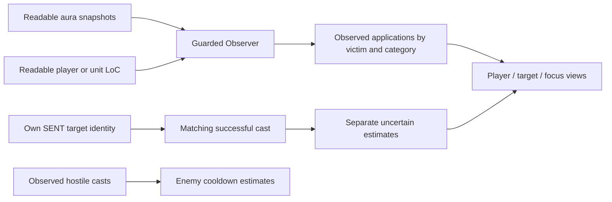

# bjarkiCC architecture and DR research

## UNIT_AURA input path in0.4.22

Main forwards the readable unit token plus update payload to `Observer.OnAura`. The adapter accepts ordinary readable harmful mapped aura records from `addedAuras`. For `updatedAuraInstanceIDs`, it queries each unique readable ID once through `GetAuraDataByAuraInstanceID`, requiring readable matching identity and harmful classification. A nil, hidden, mismatched or failed lookup is not a removal. Existing model identity and start/expiry refresh rules remain in force; an updated ID alone is not proof of a new application.

The matching-build generated schema defines `addedAuras`, `updatedAuraInstanceIDs`, `removedAuraInstanceIDs` and `isFullUpdate`. The event itself can be secret when auras are restricted. The instance API also requires unit-aura access; it is not a workaround for that restriction. This path consumes usable events when available, and rejects hidden payloads. [Pinned event structure](https://github.com/Gethe/wow-ui-source/blob/b401e0332adfbf0460d319b06d8ea29279a941f1/Interface/AddOns/Blizzard_APIDocumentationGenerated/UnitConstantsDocumentation.lua), [pinned event and instance API restrictions](https://github.com/Gethe/wow-ui-source/blob/b401e0332adfbf0460d319b06d8ea29279a941f1/Interface/AddOns/Blizzard_APIDocumentationGenerated/UnitAuraDocumentation.lua).

Each event is bound to its current readable tracked player GUID and consumed synchronously by one Scan. Target/focus aliases share that scan. Event positives take precedence over same-frame empty indexed results without upgrading the whole snapshot to complete. Exact removed keys are excluded from the snapshot, and `Model.EndAuras` closes existing matching instances before Observe. It cannot create category history or end other overlapping effects. Confirmed removals are retained in a512-entry closed-instance cache per tracked GUID so stale unchanged returns do not restore activity or advance a stage; real later refresh evidence still follows normal rules. Partial omissions remain unknown. The existing128-GUID limit remains.

The caller does not iterate secret tables, measure secret arrays or branch on hidden fields. Each container/entry/identity/classification/timing read is guarded. Each array is capped at512 entries; invalid input can only reduce coverage. The recorded `auraEventsAdded` count is accepted unique records within each event (including positive updated-instance results), not a count of distinct applications across events. `auraEventsRemoved` counts known instances actually closed; `auraEventsBlocked` covers inaccessible payloads or structural fields. Recent diagnostics retain the event status and record/removal-ID counts without printing hidden values.

The rendering change is independent: `SetDrawSwipe(false)` removes the dark radial mask for DR while preserving the requested native frame and final-five-second number. Enemy cooldowns explicitly retain swipe drawing. Tests verify flags, not live pixel appearance.

Validation separates input-routing correctness from live coverage. Real-module fixtures reproduce blocked indexed reads with readable event additions/removals, bounded stress, repeated aliases, accepted refreshes and rejected hidden data. No claim is made that Forever actually exposes those records during the user's restricted periods. No reset clock, stage boundary, category or cast-prediction policy is changed by this release.

## Visual correction: native frame and deterministic Hibernate art (0.4.21)

Use the requested action-bar atlas with `SetBlendMode("ADD")`, transparent panel backing, stage tint above the sweep and 46:45 sizing derived only from saved icon size. This restores the native frame shape without multiplying its black border pixels over icon artwork. The plain four-texture outline remains a compatibility fallback only. No protected dimensions, backdrop templates, new frame callbacks or tracking-policy changes are introduced.

`Data.auraIcons` supplies Hibernate's `Spell_Nature_Sleep` texture for spell IDs2637/18657/18658 independently of the cooldown catalog. `textureFor` checks this explicit mapping first, so caster/recipient views cannot disagree due to spell-texture API availability. The previous API-first path could substitute category Polymorph art when Hibernate's texture was unavailable, since Hibernate was absent from `Data.spells` by design (no cooldown). Tests exercise real UI rendering across all three ranks/views and five API outcomes. This reproduces and closes that fallback path; it does not prove the supplied screenshot used that path.

All tracking modules and timing settings remain unchanged from0.4.20. The reported delayed/restricted observations remain unresolved. Atlas selection and blending are verified offline; final in-game appearance is not.

## Shipping policy: application deadline and post-CC visibility (0.4.20)

Main constructs `Model.New(20,20,true)`. The third argument selects the requested application policy: every confirmed application sets `stageResetAt = appliedAt + 20`, and both displayed countdown and stage history expire at that deadline. CC duration, spell rank, early removal and immunity/rejection attempts do not add a post-end interval. Duration-based baseline reconciliation is disabled in this policy. Earlier research and release sections below describe alternative/legacy policies, not proof of Forever's server implementation.

The model still tracks effect identity and activity independently. UI suppresses active categories and standalone cast estimates, then renders inactive categories only while their application countdown is positive. Partial omissions preserve activity; complete absence or readable expiry can end it. Relevant aura/LoC events scan synchronously and request a draw on the next OnUpdate, rather than waiting for the normal 0.1-second render interval. The 20-second window is not restarted by that draw or by subsequent empty scans.

The two-argument Model constructor retains legacy end-based behavior for earlier recorded-trace regressions. Live Main always opts into application policy. New policy tests cover 2/3/4/20/30-second effects, early removal, stable rejected attempts, successive confirmed applications, exact expiry, ongoing effects after expiry, and prevention of duration-based early reset. Historical trace fixtures explicitly opt into legacy behavior so their evidence scope remains visible.

Icons no longer use `UI-HUD-ActionBar-IconFrame`. Four one-pixel textures provide stage tint above the cooldown sweep, over transparent backing and full-bleed art. No backdrop template or protected geometry read is introduced. Schema 9 normalizes both saved timing fields to 20, preserving existing grid offsets and other appearance/filter settings; obsolete timing sliders are replaced by a fixed-policy explanation.

This implementation follows the user's requested timing contract. The screenshot's “A more powerful spell is already active” proves that particular recast was rejected; it does not independently establish a universal reset formula. Confirmed enemy observations can still be unavailable.

Research checked 2026-10-17. This document separates source evidence, addon policy, reported behavior and offline validation.

## Findings that matter for this bug

The DR **stage** can change as soon as a CC application is observed. That does not make the application's time the start of the later **reset window**. Diminish supports displaying a category immediately on application, but its implementation extends the expiration to the aura's end plus the reset interval and updates the expiration when the aura ends. Its application display option therefore does not implement a duration-independent, application-only reset clock. [Diminish timer implementation, pinned source](https://github.com/wardz/Diminish/blob/eef7b235c53194e62da8e996ee41f2c5acf3a883/Diminish/core/timers.lua)

The DRList author's simpler example starts/updates a timer on aura removal or refresh. This is a usage example, not a complete specification for overlapping effects or all refresh edge cases. [Author's example, edited 2025-05-25](https://github.com/wardz/DRList-1.0/wiki/Example-Usage)

The user's requested application-only timer is a legitimate addon display policy to preserve, but the repository must label it as an estimate chosen for this addon, rather than claim research proves it is the Classic/Forever server reset rule. Showing an icon immediately and knowing the server's exact reset deadline are separate requirements.

## Classic Era baseline

The inspected DRList Classic profile represents successive CC durations as full, half, quarter, then immune. After observing the first successful application, a next-application indicator therefore reads 50%; after the second, 25%; after the third, immune. Its Classic reset interval is 20 seconds, explicitly a conservative maximum for a dynamic 15–20-second reset. This does not establish a fixed 20-second server timer, nor an 18-second Classic rule. The profile's ordinary-NPC categories are controlled stun and Kidney Shot; player rules should not be applied indiscriminately to every creature. Its automatic unknown-project fallback selects MoP, so Forever must select a deliberate profile rather than inherit that fallback. [DRList core, revision 82](https://github.com/wardz/DRList-1.0/blob/05c3c794fc18791d2173ea5361a6aa9c0029d91f/DRList-1.0/DRList-1.0.lua)

The following are selected mappings from its **Classic** spell table, not the Retail table:

| Category | Examples |
| --- | --- |
| Controlled stun | Hammer of Justice, Cheap Shot, Bash, Pounce, Charge stun, Intercept stun, War Stomp |
| Random stun | Mace stun, Blackout, Impact, Seal of Justice stun |
| Kidney Shot | Kidney Shot |
| Incapacitate | Polymorph, Sap, Gouge, Freezing Trap effect, Scatter Shot, Hibernate, Repentance |
| Fear | Fear, Psychic Scream, Howl of Terror, Seduction, Intimidating Shout |
| Controlled root | Entangling Roots, Nature's Grasp, Frost Nova, Counterattack |
| Random root | Improved Wing Clip, Improved Hamstring |
| Mind control | Mind Control, Gnomish Mind Control Cap |
| Frost Shock | Frost Shock |

Thus Kidney Shot is separate from HoJ/Cheap Shot; random stuns and roots are separate from their controlled counterparts. The source combines Era and Season of Discovery entries, explicitly marking SoD additions. Copying the entire table would silently import those additions. Blind, Death Coil, and silence/disarm categories are not entries in this inspected Classic table; absence alone is not proof of their Forever behavior. [DRList spell table](https://github.com/wardz/DRList-1.0/blob/05c3c794fc18791d2173ea5361a6aa9c0029d91f/DRList-1.0/Spells.lua)

## Forever evidence and uncertainty

Blizzard's beta development notes through the update titled October 15 and its known-issues topic updated October 8 were searched for DR rules. Neither reviewed page specifies a CC DR reset clock or a complete category mapping. That is a bounded finding about these pages, not proof Blizzard has never documented it elsewhere. The development notes do establish changing class tuning: the October 15 update changes War Stomp's cooldown to 90 seconds from 120. Cooldown tuning and DR rules must be versioned separately. [Blizzard development notes](https://us.forums.blizzard.com/en/wow/t/wow-forever-beta-development-notes-%E2%80%93-updated-october-15/2360696/6), [Blizzard known issues](https://us.forums.blizzard.com/en/wow/t/wow-forever-beta-known-issues-october-8/2352687)

A newly published Forever-specific addon provides a useful independent maintainer report: DRTrackerForever targets 1.60.1, reports hidden combat logs/enemy auras and a disabled native DR system, and supplements visible auras with player/group casts. Its README uses 18 seconds after the last CC ends. This is an implementation assumption/maintainer report, **not Blizzard confirmation** of that number. Its code comments specifically report `C_SpellDiminish.IsSystemSupported()` returning false and use `UNIT_SPELLCAST_SENT`, `UNIT_SPELLCAST_SUCCEEDED`, `UNIT_COMBAT`, readable aura APIs, and player loss-of-control data. [Maintainer README](https://github.com/Pirson-s-Addons/DRTrackerForever/blob/231dbfd544e3248db2bcb5445a96db272a503d87/README.md), [source adapter](https://github.com/Pirson-s-Addons/DRTrackerForever/blob/231dbfd544e3248db2bcb5445a96db272a503d87/Core/Sources.lua)

The report is consistent with the user's symptom: player CC can be observable through player loss-of-control data while outgoing CC on a target is unavailable to an aura-only observer. It does not prove the exact cause of this user's missing target icon. That requires the current observer path and runtime diagnostics.

## Recommended architecture boundaries

These are design recommendations derived from the above limitations, not additional claims about Blizzard internals:

1. Maintain one state per victim GUID and category. Player, target and focus are views of that state, so self-targeting or sharing a target and focus cannot count the same application twice.
2. Keep cast/cooldown observation separate from CC application evidence. A successful cast event does not prove an effect landed: resistance, immunity, travel, crowd-control target changes, ground traps and area effects can intervene.
3. Record the evidence source on each observation: readable aura, player LoC, inferred own cast, or unknown. An inferred cast may start an estimated display immediately; it must not be promoted silently to a confirmed application.
4. Capture a readable intended target at cast-send time where available and correlate it with the cast identifier. Do not assign a delayed successful cast to whichever target happens to be selected later. Skip ambiguous or secret identities; do not guess an area spell's victims.
5. Deduplicate an inferred own cast against its later readable aura. Update the same application rather than advancing the stage twice. Aura instance IDs are stronger evidence than matching a spell name in a short time window.
6. Do not advance confirmed DR on an immune/resisted attempt that produced no observed application. A generic miss event without spell/cast attribution is not enough to undo one exact record. A break/removal ends an observed effect; it should not erase the fact that it was applied.
7. An aura refresh may represent another application, but an unchanged repeated snapshot does not. Do not infer a new stage merely from polling; require a new instance or reliable refresh evidence, otherwise expose uncertainty.
8. Store stage progression, active-effect coverage, and timer policy independently. For the current application-only policy, removal must not restart the displayed timer. The user explicitly selected separate post-CC stage retention for 0.4.7 while keeping the application countdown. The two clocks must not be conflated.
9. Keep Classic-derived spell groups provisional on Forever. Do not import Retail's current categories, changing reset times, or immunity thresholds, and do not treat arbitrary new beta spells as Classic equivalents without evidence.

## Small live validation protocol

Record build, spell rank/ID, victim, application time, early-break/removal time, next-cast time, actual resulting duration, and the addon's evidence source. Repeat the same category, then a cross-category pair such as Cheap Shot/Kidney Shot. Use both an immediate-break trial and a full-duration trial; if a later full-duration CC returns at different times, those trials distinguish application-based and removal-based reset hypotheses. Repeat near the candidate reset boundary instead of treating one successful cast at 18 seconds as proof of a fixed timer. Separately test own CC on target and focus, a focus macro while another target is selected, same GUID in multiple views, resisted CC, and a visible aura arriving after a cast estimate. These checks require in-game evidence; offline tests can only verify state-machine behavior under supplied inputs.

## Exact source versions

| Source | Inspected revision/date | Evidence ceiling |
| --- | --- | --- |
| wardz/DRList-1.0 | `05c3c794fc18791d2173ea5361a6aa9c0029d91f`, 2026-02-17, library revision 82 | Maintainer's Classic data and estimates; not Forever server source |
| wardz/Diminish | `eef7b235c53194e62da8e996ee41f2c5acf3a883`, 2026-08-01 | Actual addon application/removal behavior; not proof it works on Forever |
| DRList example wiki | Last edit shown 2025-05-25; checked 2026-10-17 | Author's simplified API-use example |
| Pirson-s-Addons/DRTrackerForever | `231dbfd544e3248db2bcb5445a96db272a503d87`, 2026-10-14 | Current beta maintainer report and source strategies, not independent validation |
| Blizzard Forever development/known-issues topics | Updates titled 2026-10-15 / 2026-10-08; checked 2026-10-17 | Official notes for documented changes; no reset/group specification found in these pages |

No implementation code from these projects was copied into bjarkiCC by this research task.

## Implemented architecture in 0.4.19-beta

Target client: **WoW Forever beta 1.60.1.70425**, interface **16001**. The user explicitly chose to keep the **application-based display timer** after the Classic distinction above was explained. A new application starts or refreshes the configured timer, default 20 seconds; breaking/removing CC does not restart it. Starting with 0.4.7, the user also explicitly chose to retain stage history separately until the configured interval after CC ends. Version 0.4.8 separates the settings: `resetSeconds` keeps the application countdown (default 20), while `stageResetSeconds` defaults to 18. Missing legacy stage settings receive 18 without changing existing display preferences; explicit overrides survive reload. Both settings are guarded and bounded to 10–30 seconds. Stage coverage/confidence uses the stage interval; cast predictions and confirmations keep the application interval. These are addon estimates, not a verified Forever server-reset rule.

### Reported incoming/outgoing asymmetry

The user reports that receiving CC starts DR, but applying CC does not. Screenshots show native portrait CC art, and uneven icon placement around portrait badges. Source inspection confirms that version 0.3.1 had a player Loss of Control fallback, but no corresponding target/focus path when harmful aura IDs were unavailable. Screenshots alone cannot determine whether a particular missing effect was secret, unmapped, unsupported or outside the Classic DR profile. Sap, Cheap Shot, HoJ and Polymorph are already mapped.

Installed bjarkiPortraits uses native `AuraContainer` / `CustomAuraContainerTemplate` with a `HARMFUL|CROWD_CONTROL` semantic filter. A native widget can display CC while ordinary addon Lua cannot read its spell identity. Its visible icon therefore is not proof of usable application evidence.

Forever's API source exposes ByUnit LoC methods, but their records can be conditionally secret. Version 0.4 accepts only readable positive witnesses; API existence is not guaranteed live coverage. The native SpellDiminish API is also not an unrestricted substitute for this observer. [LossOfControl API](https://github.com/Gethe/wow-ui-source/blob/forever/Interface/AddOns/Blizzard_APIDocumentationGenerated/LossOfControlDocumentation.lua), [SpellDiminish API](https://github.com/Gethe/wow-ui-source/blob/forever/Interface/AddOns/Blizzard_APIDocumentationGenerated/SpellDiminishUIDocumentation.lua)

### Data flow

Client inputs pass accessibility/secret checks before truthiness, comparison, indexing, formatting or arithmetic. Failed API calls or unreadable fields become unavailable evidence. No combat-log events are registered. The addon does not identify spells from protected native portrait output.

### Readable applications

One snapshot is taken per GUID, preferring player, then target, then focus. All identities are resolved before releasing history, so self-targets, shared target/focus, swaps and clearing one alias cannot double-count or erase another alias's observation history. Losing every tracked reference releases observed DR. Gaps above one second invalidate confidence before fresh snapshots are consumed.

The player keeps a successful LoC fallback until observer reset. Switching sensors for the same GUID invalidates confidence without deleting already observed category stages or deadlines; retained identities reconcile the incoming evidence. Target/focus merge readable ByUnit LoC witnesses when the harmful aura scan is incomplete. Full aura coverage is still the completeness authority: an empty LoC list cannot prove that omitted roots, slows or other categories ended. Exact aura instance IDs normalize across sources. A sole cross-source candidate keeps its canonical identity while retaining readable explicit LoC timing, so a later start can identify a reapplication without duplicating an unchanged effect. Such identity matching stays uncertain; multiple indistinguishable candidates do not establish a new application. Retained identities are bounded during prolonged incomplete scans; capacity is reported in diagnostics.

`Model:Observe` owns observed applications. New identities advance the category and set its application deadline. The observer preserves a readable LoC `startTime`, or derives a start from separately validated aura expiration and duration. No start is derived from `now + timeRemaining`. The model uses the original start: first discovery nine seconds late leaves eleven seconds of a 20-second timer. An already-expired application retains its identity without creating a fresh timer. Newly readable original timing can correct an existing untimed identity without advancing its stage.

Display expiry does not erase the last observed category record or reset its stage. Keeping one current record and at most one flat predecessor per category per retained GUID (at most 128 GUIDs) lets a delayed application chain against the previous application timestamp, even when that previous application countdown has finished. For example, applications at 0 and 10 seconds still form stages one and two when the second becomes readable at 21 seconds; only nine seconds remain on its timer. If its identity arrives before its timestamp, the predecessor lets that later timing correction reconcile the stage without counting a new application. There is no recursive history chain. A genuine next application starts stage one only after the separate stage reset window has expired; the application countdown reaching zero is insufficient. Older witnesses cannot rewind a newer deadline. Losing the last tracked reference still forgets that GUID's observation history.

A stable identity with an already readable explicit LoC start followed by a later explicit LoC start can be a reapplication. An aura-derived start is not an equivalent baseline: the first explicit LoC timestamp calibrates that application regardless of its relation to local first-seen time. Before explicit LoC timing is known, aura-to-aura refresh inference requires both the start to advance and the expiration to change; expiration may become earlier when DR shortens the new CC. The result remains uncertain because a snapshot cannot fully distinguish a refresh from a duration correction. Sub-millisecond timing jitter is ignored. Ordinary unchanged polling, duration-only correction with unchanged expiration, and bare expiry extension without a readable start do not multiply stages. Removal updates the separate stage-reset clock and never restarts the application countdown. Partial snapshots retain potentially hidden effects and invalidate confidence.

Version 0.4.6 extends clock calibration across timing sources. In the live 0.4.5 recipient report, `a:325` first had aura-derived start 2655626.973, then an unknown LoC start, then explicit LoC start 2655627.250. Comparing the two sources counted that first Hibernate twice. Its real later LoC refresh at 2655637.750 then displayed stage three instead of two. The first explicit start now corrects the existing record; subsequent LoC-to-LoC refreshes still advance normally. Once explicit LoC timing is known for the identity, lower-quality aura samples and older LoC times cannot replace the comparison baseline or create a later duplicate when the original time returns. The record remains bounded; no extra timing grace period or history stream is added.

This source precedence has an explicit limit: if a real same-ID reapplication happens before the first readable LoC time, that time alone cannot distinguish it from initial clock calibration. Likewise, an aura-only timing change after explicit LoC timing is known does not establish another application for that identity. Such ambiguity must remain uncertain, rather than invent a count; a newer explicit LoC start or a genuinely new aura identity still supplies progression evidence. This source precedence does not change the application countdown. The separate stage-reset policy added in 0.4.7 is described below.

Version 0.4.5 distinguishes first timing calibration from a subsequent refresh. The recipient's 0.4.4 live trace showed the same Hibernate instance `a:315` advancing from stage one to two when its start changed from unknown to 2655121.750, and `a:319` advancing from two to three when its start changed from unknown to 2655187.000. Each readable start was slightly later than the local first-seen fallback. That fallback is not a known application time and cannot establish a second application. The first readable start now corrects the existing record and reconciles its predecessor without incrementing the application count. Later known-to-known refreshes and distinct real aura IDs retain their existing behavior. The observer still rejects future timestamps: a fixture with a briefly future start reproduces the normalized trace, but the report does not reveal why the original raw start was unavailable. No extra timing tolerance or server reset assumption is introduced.

Version 0.4.3 applies the timing tolerance to fallback identity as well as refresh checks. A no-instance LoC key embeds its start time; previously a 0.0001-second correction generated a different key and bypassed the model's refresh tolerance. Reconciliation retains the original fallback identity/start for a same-spell correction within 0.001 seconds, without moving the tolerance forward on every poll. Distinct real aura IDs are not collapsed. One immutable witness record is retained with the category (and its existing flat predecessor), allowing the same application to return after a complete empty snapshot without counting again. The active-effect list still empties on removal; newer explicit start times still count as new applications. No unbounded identity cache is added.

### Separate application display and stage reset

Version 0.4.7 keeps `started`, `duration` and `remaining` as the requested application countdown. Observed stage continuity instead uses the category's latest CC end plus the configured reset interval. `stageResetAt` and `stageRemaining` expose a known or predicted deadline; `stageResetPending` identifies an unknown end, and `stageResetSource` distinguishes observed disappearance from predicted expiry. A row remains available while its stage is retained, even when application `remaining` is zero. The model continues returning that retained row for diagnostics and progression. Starting in 0.4.8, the UI filters rows with zero application time before layout, icon limits and overflow counting. It does not delete model history. If the stage expires before the application countdown, the model stops returning the expired stage; no stale color remains. The separate reset estimate appears in status and on hover while visible.

Complete disappearance of an already observed effect records its end at the earlier of the scan time and an accepted earlier expiry. Repeated empty scans cannot slide that end. Partial absence never proves removal. Readable expiry supplies a bounded prediction when no removal is observed; an active effect with no readable end keeps the reset pending and uncertain. Overlapping effects share the latest end for the category. A stable witness returning with a future expiry is treated as an uncertain visibility gap without another application count; an already-expired stale return cannot slide its recorded end. Storage stays bounded by the existing GUID/effect caps and flat predecessor.

The 0.4.6 report contains a 10-second LoC interval at 2656289.250 followed by a 5-second interval at 2656299.250, counted once each as stages one and two. It does not capture the earlier full application. A hypothetical full 20-second Hibernate ending before those entries reproduces the policy undercount: the old application-only rule dropped stage one before the next diminished effect. This demonstrates a source-policy limitation, not proof of the missing live sequence. Version 0.4.7 did not use duration to correct stages. Its full/half/quarter replay checks progression while the requested application clocks remain unchanged.

### 0.4.7 live reset mismatch and 0.4.8 estimate

The complete recipient trace shows two ordinary 1→2→3 sequences without the earlier timestamp-calibration duplicates. The second sequence ends `a:383` at observed disappearance 2657449.235 (its predicted expiry was 2657449.500). A new `a:385` has explicit start 2657467.250 and end 2657487.250: a full 20-second interval, 18.015 seconds after observed disappearance and 17.750 seconds after the old predicted end. With the old 20-second post-CC window, the model still retains stage three until 2657469.235 and advances/caps it at three again. The model therefore reproduces the reported red full-duration CC without duplicate counts, own-cast estimates or scan gaps.

The independently configured 18-second stage estimate resets the prior stage at 2657467.235 and starts `a:385` at stage one, preserving its 20-second application countdown. This clears the recorded boundary by only 15 milliseconds. The trace establishes that the old conservative model retained history too long for this observed application; it does not establish a universal or exact server threshold. Version 0.4.8 introduced no duration heuristic or special Hibernate override. Version 0.4.9 adds the bounded full-duration correction below. DRList's source documents a dynamic 15–20-second Classic interval and chooses its maximum; that reference does not verify Forever's rule. Keep the new value configurable and validate repeated trials at the boundary. Pure cast estimates retain their existing limitations.

### 0.4.13 sequence evidence across a nonoverlapping same-ID refresh

The 0.4.12 recipient trace reaches candidate step two after `a:519` (20 seconds) and `a:521` (10 seconds). At 2661841.940, the same `a:521` supplies a new explicit start 2661841.750 and duration five; that start equals the preceding explicit end. The last snapshot still contains the preceding effect, so its immutable context has no observed absence and reports overlap. Version 0.4.12 therefore drops the candidate. The later full `a:523`, starting 16.925 seconds after observed removal of the quarter effect, and half `a:525` both remain stage three with no learned baseline. This is a sequence-learning omission, not an extra application or an immune attempt moving the countdown.

A separate successor proof is now captured before mutating the accepted predecessor. It applies only to a genuine same-key explicit LoC refresh of the directly tracked real aura instance, with matching accepted spell/category/start, a coherent previous raw duration/end, a nonnegative gap shorter than 15 seconds and no other same-category records in either snapshot. Incomplete coverage, pending/unknown ends, fallback identities and a merely retained closed witness cannot supply it. The existing candidate epoch, exact predecessor, inferred-stage veto and D, D/2, D/4 consistency checks still apply. If another category witness appears before the first raw duration arrives, the pending proof and candidate are invalidated even if that witness disappears again.

This proof is consumed only by the three-application sequence learner. It does not mark `priorEndObserved`, manufacture `quietSince`, or relax the quiet-baseline and later reset-correction gates. Explicitly observed absence is still required for the subsequent full-duration correction. Neither configured clock changes. Sequence learning continues to carry the `observed-halving-chain` provenance and remains an inference under the provisional profile.

The exact a519/a521/a523/a525 replay exercises Main, Observer, Model and all three UI frames without inserting an empty scan between the half and quarter applications. Additional model cases reject overlaps, incompatible identity/timing, partial coverage and gaps that could contain a reset. Offline evidence confirms this branch; live behavior remains to be checked.

### 0.4.12 native action-button artwork

`UI.lua` uses `UI-HUD-ActionBar-IconFrame`, the normal button bevel in Forever build 70425, rather than the equipped-item glow named `UI-HUD-ActionBar-IconFrame-Border`. The source normal texture is 46 by 45, top-left aligned to a 45 by 45 button; bjarkiCC derives that ratio from its own configured icon size. `SetAtlas(..., false)` uses the atlas UVs, and `SetVertexColor` retains the existing stage palette. Enemy cooldowns use white vertex tint, preserving the artwork's neutral appearance. The existing spell-art inset/crop stays unchanged. [Exact beta action-button template](https://github.com/Gethe/wow-ui-source/blob/b401e0332adfbf0460d319b06d8ea29279a941f1/Interface/AddOns/Blizzard_ActionBar/Mainline/ActionButtonTemplate.xml#L146)

The border is a plain texture on the text layer above the cooldown widget. No native action-button template, input handling or protected geometry read is inherited. A guarded `C_Texture.GetAtlasInfo` lookup falls back to four constant-width edge textures if the asset is unavailable. Unlock handles keep their simple panel borders. Both paths preserve the earlier Backdrop.lua fix and use saved numeric sizes, with no `GetWidth`, `GetHeight` or scale arithmetic. Application/stage model behavior is unchanged. Offline fixtures cover native artwork, stage tint, layer ordering, unavailable-atlas fallback and restricted geometry during repeated CC and layout changes; they do not render the live client.

### 0.4.11 corroborate a full duration from a complete observed sequence

The 0.4.10 trace has preserved source handoff and explicit raw duration, but only 13.851 seconds of initial complete observation before `a:477` at 2660057.750. The first raw 20/10/5-second sequence counts as 1/2/3. No full-duration baseline can be learned under the earlier 20-second quiet gate. The next full `a:483` at 2660110.000 arrives 15.888 seconds after the preceding quarter CC's observed disappearance, yet remains three; its raw 10-second same-ID refresh at 2660121.000 also remains three. Replaying with only a longer initial quiet period changes that outcome to one then two, establishing the eligibility limitation without another reset-constant adjustment.

The quiet-based path remains. An additional candidate tracks three consecutive explicit LoC durations D, D/2 and D/4 for the same victim, category and exact spell. Under the provisional full/half/quarter/immune profile, three nonzero consecutive applications with that pattern corroborate that the first was full. A lone cold-start sample, two halving samples, or a maximum duration alone cannot establish this. The resulting baseline source is `observed-halving-chain`; the existing path is `quiet-observation`.

Candidates require complete observation within one coverage epoch, first coherent raw duration per application, stages exactly 1/2/3 without inferred elevation, and exact immediate predecessor identity/time/stage. For each transition, both the accepted prior end and its first observed absence must precede the new application by less than 15 seconds, and the configured stage window must still retain the predecessor. Pending ends, overlap, missing evidence, an intervening same-category application, conflicting initial aura duration, or a reset break the sequence. Candidates are bounded by category and cleared on partial coverage or forgetting the victim. Unrelated categories cannot complete each other's sequence.

Completion learns the first D; it does not reinterpret any current application's stage from a duration ratio. The later full-duration correction still requires its existing matching explicit duration, at least 15 seconds of actually observed absence and no overlap. The 20-second application display and configured stage-reset estimate remain independent. The sequence premise is provisional profile evidence, not a server DR-state query or proof of an exact Forever reset threshold.

GetDR exposes learned duration/source and pending candidate progress for diagnostics. Status and bounded recent history record baseline acquisition, absence and provenance; corrected tooltips identify sequence-derived evidence. The exact trace and a separately labeled synthetic next quarter application exercise shared player/target/focus stages and clocks. Live validation remains required.

### 0.4.10 preserve qualified evidence across an exact source handoff

The new 0.4.9 trace begins with complete empty aura observation at 2659009.170. Its first `a:421` arrives through aura data at 2659029.859 and immediately switches to complete LoC observation with the same ID. At 2659030.143 it supplies explicit start 2659030.000 and raw duration 20. The later full `a:427` starts at 2659080.750, 15.630 seconds after the preceding quarter effect's observed removal, yet remains stage three. Its subsequent raw 10- and 5-second applications also stay three.

The failure is an internal coverage reset: Observer injected `Observe(guid, {}, now, false)` solely because the sensor changed. The model correctly invalidated its duration epoch, making the first application's previously captured quiet context ineligible. No baseline was learned. The old integration fixture had a restricted aura source before its quiet period, selected LoC early, and therefore failed to exercise this boundary. Removing just that artificial invalidation in a diagnostic replay restores baseline learning and the later stage correction without changing a timestamp or reset threshold.

The replacement keeps the invalidation for unproven source switches. It preserves prior context only for the player's one-way aura-to-LoC transition when both normalized snapshots are complete/readable and their nonempty witness sets have the same real aura-instance keys, spell IDs and categories. The prior witnesses must have readable finite aura-derived start and expiry with positive duration no greater than 120 seconds. Fallback identities, ambiguous canonical matches, capacity limits, empty/different witness sets and reverse switches do not qualify. A real scan gap is invalidated earlier and is never undone by this handoff check.

Exact identity can persist across a reapplication, so baseline learning also checks the initial application's aura-derived duration against the later explicit LoC duration when available. A mismatch vetoes learning; the aura duration is never used to learn full duration or infer a half/quarter stage. The first explicit LoC start still calibrates its existing identity without a duplicate application. Application/stage clocks and the 0.4.9 full-duration correction conditions are unchanged. Source-handoff counters make preserved and invalidated transitions visible in status.

### 0.4.9 full-duration evidence correction

The next 0.4.7 trace includes an immune-cast reproduction report, but the observed record contains no immune-attempt transition. All own-cast counters are zero. `a:403` starts at 2657960.000, predicts expiry at 2657965.000, and disappears at 2657965.070. The model accepts the earlier end, 2657965.000. `a:405` is first seen untimed at 2657980.436 and later exposes start 2657980.500/end 2658000.500: full duration, 15.500 seconds after the accepted prior end (15.430 after the removal scan). The 20-second model and the 18-second model both keep stage three. Injecting an unconfirmed cast at the immune stage does not alter either deadline. The 152 API errors in the report do not identify an error message or demonstrate a causal link.

This evidence rules out treating the earlier 18.015-second success as a universal reset threshold. Version 0.4.9 leaves the configurable estimate unchanged and adds a bounded, explicitly uncertain correction from matching full-duration evidence. It does not change the global estimate to 15 or infer arbitrary stages from duration ratios. Diminish also uses duration evidence, but its broad remaining-time ratio heuristic is not copied here. [Diminish timer implementation](https://github.com/wardz/Diminish/blob/eef7b235c53194e62da8e996ee41f2c5acf3a883/Diminish/core/timers.lua)

The Observer now supplies `reportedDuration` only from a finite positive raw LoC duration no greater than 120 seconds, with an accepted explicit start. Aura-derived starts and `now + timeRemaining` never create this field. Exact and canonical sensor merges carry its provenance; a current missing duration cannot inherit an old value for a new boundary. Explicit start/duration/expiry must agree before the model uses this evidence. The captured start/end pairs motivate the regression, but the old report did not separately record raw duration; live confirmation of the new field remains necessary.

The model keeps a full-duration baseline by victim GUID and exact spell ID, capped at 64 spells per victim. A baseline is eligible only after at least 20 seconds of continuously complete observation and category absence, without pending or overlapping effects. It is not learned from an already-active first observation, an uncertain cast or arbitrary maximum seen duration. Partial observation and scan gaps invalidate baseline evidence; losing the final unit reference forgets it. Pre-application coverage and prior-end context are retained before processing current removals or inserting new clocks, so late readable timing is assessed against the earlier quiet interval. A predicted expiry noticed late cannot backdate observed absence.

A new observed application may correct retained stage history only when its first coherent explicit duration matches that baseline within 0.001 seconds, at least 15 seconds have passed since both the accepted prior category end and the first complete observation of its absence, and no preceding overlap or pending end remains. The earlier absence must come from a preceding snapshot. Correction sets stage one, clears inherited cast-stage elevation, preserves the accepted application timestamp, and sets `resetEvidence = matching-full-duration`, `resetBaselineDuration` and `resetPreviousStage`. The row stays uncertain because this is observed-duration evidence for a reset, not authoritative server DR state. Ordinary polling, later duration edits to the same known application, missing/secret data, different spells/victims and cast success alone cannot perform this correction. Subsequent genuine applications advance normally; timestamps becoming readable must not re-inflate the corrected stage.

Status and tooltip expose the correction. Trace signatures include newly reported durations and correction changes, while drifting remaining-time expiry is still omitted from the signature. This remains bounded history. The independent 20-second application display, hidden icons after expiry and configurable post-CC stage estimate are preserved. The 15-second eligibility floor and 20-second baseline quiet interval derive from the provisional Classic range, not a newly proven Forever rule.

### Own-cast estimates

Since 0.4.19, cast predictions are disabled by default; schema 8 also turns the earlier automatic setting off once without moving the grids. A later deliberate opt-in persists across reload and the settings label warns about dodges/resists. Successful casting does not imply a landed hit, and the source could reproduce a stage-one tracker with SENT/SUCCEEDED but no application. No reliable dodge event is inferred to repair a prediction after the fact. Confirmed aura/LoC observations remain independent; unavailable outgoing evidence can leave no tracker under this policy.

When explicitly enabled, only an allowlist of targeted CC can predict DR; area spells, traps and procs are excluded. `UNIT_SPELLCAST_SENT` matches the intended name against readable player target/focus candidates, rejecting ambiguity between those candidates. Readable `UnitName`/`UnitFullName` fields generate exact bare, hyphen-qualified and space-qualified aliases; realm whitespace is normalized for hyphen-qualified names, without stripping or guessing character spelling. Aliases of one GUID share names before checking for missing data. Unknown distinct identities or ambiguous same-name GUIDs still reject the estimate. It supplies a name, not a victim GUID: a same-name destination outside target/focus (for example a mouseover) cannot be ruled out. `UNIT_SPELLCAST_SUCCEEDED` must match the cast identity and spell. Failed/interrupted casts and expired pending records are discarded. Target changes after send cannot redirect the stored candidate. The estimate starts at success, which approximates rather than proves application time. Dodged, resisted or immune hits can still produce a prediction when this optional setting is enabled.

Pending cast estimates live outside the observed effect/category tables and carry `estimated=true` and `uncertain=true`, with a stage-colored border and an explanatory tooltip. Since 0.4.3, DR uncertainty has no on-icon question mark; it remains explicit in the tooltip and diagnostics. Readable applications take precedence without advancing observed stages twice. When only the second of two inferred applications becomes readable, the current application is confirmed (`estimated=false`) but its earlier inferred stage is retained separately as `inferredStage`. Output rows expose the observed count as `observedStage` and the optional displayed count as `stage`; `stageEstimated=true` and `uncertain=true` identify any elevation from inferred history. This does not promote the first cast to an observed hit. If a same-spell application becomes readable without timing, its earlier cast clock is retained as `timeEstimated`; confirmed application evidence does not silently make that clock exact. Disabling the option restores the observed count and hides pending predictions. A successful cast can still be resisted or immune; a generic miss event cannot reliably identify a particular cast to undo. Pending records, predictions and duplicate identities are bounded.

At the final displayed stage, another unconfirmed cast cannot extend the category's deadline. `EstimateDR` selects the same unexpired observed/predicted base used for stage progression; if its displayed count (including inferred history) is already three, it retains the timer and rejects the new estimate. The cast ID is still recorded for deduplication, so its replay after expiry cannot create a fresh window. Moving from stage two to three still starts the third application's timer. A retained observed stage remains the base even after its visible application countdown ends. Pure predictions still expire at their application deadline because they contain no observed CC end; after that, any retained observed stage becomes visible again. Cast success alone cannot reset retained observed history; a fresh stage-one base requires its expiry or separate observed full-duration correction. This guard affects only cast predictions: a readable new application remains evidence that can update history, including when an earlier inferred stage was wrong. Categories and GUIDs remain independent. No immune result is inferred from a successful-cast event.

The 0.4.1 live report recorded zero captured casts and seven unresolved destinations, with no mapped target/focus aura or LoC witness. Follow-up probes returned readable name/realm fields `Björn`, `Janson` and a SENT destination `Björn Janson`. Version 0.4.1 accepted only bare or hyphen-qualified names, which reproduces this resolution failure. Version 0.4.2 accepts the exact space-qualified alias. Its diagnostics expose fixed reason counters and a bounded, sanitized summary of readable names and alias states; GUIDs and protected values are not formatted. This is evidence for that specific matching fault, not proof of universal enemy-data availability.

### Cooldowns and spell data

Hostile readable successful casts feed an independent GUID-keyed cooldown model. Ranks normalize to a cooldown family, duplicate cast events are ignored, and observed reset spells clear only the same caster's related records. Talent ranges are estimates. Timer expiry or absence does not prove readiness. Pet records remain under pet identity, and DR observation loss does not erase independent cooldowns.

`Data.lua` explicitly selects the Classic-derived profile instead of trusting an unknown project-ID fallback. Cast and aura/effect IDs have separate mappings. There are 120 aura/effect IDs, 85 cooldown cast IDs and 27 cooldown families. Spammable CC can contribute to DR without receiving a fabricated cooldown. War Stomp's 90-second cooldown already reflects the cited beta note. [Data attribution and assumptions](THIRD_PARTY_NOTICES.txt)

### UI placement and migration

Version 0.4.18 removes the two-pixel artwork inset and opaque icon matte. Spell textures use `SetAllPoints(icon)` under the existing tinted native bevel; both native-artwork and plain-outline branches use alpha-zero backing. The cooldown sweep follows the artwork's bounds. This changes presentation only and adds no geometry reads, masks or backdrop callbacks. Native bevel shading and dark pixels within spell art remain part of those textures.

Bars remain addon-owned UIParent children. Since 0.4.17, DR grids attach beside the visible portrait edge: player `TOPRIGHT` to portrait `TOPLEFT` with `(-18,0)` offsets, and target/focus `TOPLEFT` to portrait `TOPRIGHT` with `(18,0)`. This mirrors grids outside paired unit frames and leaves a badge gap. Icons remain 28px with 3px gaps.

Portraits resolve through `PlayerFrame.PlayerFrameContainer.PlayerPortraitMask` or `TargetFrameContainer.PortraitMask` on target/focus, then portrait images/globals and finally the named native frame. `anchorFrame` retains native visibility identity; `anchorRegion` supplies geometry. Native frames and regions receive no setters or hooks. Legacy frame, portrait-side, portrait-top and health anchor kinds remain supported for explicit configurations, while new defaults use `unit-side`.

Schema 7 applies the requested side placement to all earlier DR bars once, preserving icon appearance, enable/filter settings, clocks and cooldown-bar configuration. Subsequent reloads preserve deliberate offsets. `/bcc reset` restores the side placements. Scale-aware dragging saves the grid's top corner against the corresponding portrait edge and restores native attachment. Combat defers repositioning; missing/replaced regions hide live rows until rebound. Cooldowns remain freely positioned.

DR rendering is always a fixed 2 x 2 grid, independent of old vertical/growth flags. Its width and height are `2 * size + gap`; row-major offsets use two columns, mirroring horizontal direction for player. Display at most four filtered active rows, even with a larger saved icon limit, and hide the DR overflow marker. Additional categories remain in model/status history. Test mode supplies four DR categories to preview every slot. DR options show a fixed-grid label, while cooldowns retain the vertical control and their existing overflow behavior.

Normal play has no headings or category captions. Empty bars hide. Caster names and DR percentages are optional; uncertain DR rows omit percentage text and explain their evidence on hover. Test mode is synthetic and cannot alter tracking history.

Borders show the counted/estimated stage even when history is incomplete: green, yellow, red. The tooltip explains when the actual next duration is unknown; no DR `?` badge is drawn. Cooldown readiness `?` and manual `M` markers are independent and remain. Since 0.4.16, DR numbers are blank above five seconds; exactly five shows `5`, and positive values below five use `string.format('%.1f', seconds)`. Sweeps and stage borders remain visible for the full application window. Enemy cooldown text retains its earlier floor/minute formatting. Formatting does not shift either deadline: 4.96 can display 5.0, and a positive 0.04 can display 0.0 before actual expiry.

### Logged backdrop error and rendering boundary

The user's 0.4.0 error report was corroborated by 1,632 entries in the local client log: `Backdrop.lua:226` attempted arithmetic on secret `width`, tainted by bjarkiCC, from the size-change callback. The installed UI.lua hash matched that release. The user's full subsequent trace identifies the exact icon at `UI.lua:93` with secret width and height. Native-relative geometry can become restricted even though bjarkiCC supplies ordinary numeric icon sizes. The standard backdrop template implicitly reads width/height/scale to calculate texture coordinates. Repeated resizing at the render cadence repeats that failure. [Blizzard backdrop implementation](https://github.com/Gethe/wow-ui-source/blob/forever/Interface/AddOns/Blizzard_SharedXML/Backdrop.lua)

Version 0.4.1 uses plain frames with a solid background and four constant-width edge textures on anchored bars/icons. Native texture stretching supplies the geometry; addon Lua does not read or divide their restricted dimensions. Unanchored settings/diagnostics retain regular backdrop templates. `test_backdrops.lua` models the implicit callback with a poisoned dimension, reproduces the old failure at CC removal, and exercises removal, repeated drawing, the next CC, layout controls and expiry against the replacement. This is a regression for the logged path, not proof of every protected-client behavior.

### Module responsibilities

TOC order: Bootstrap, Data, Model, Observer, OwnCasts, Anchors, UI, Main.

| Module | Responsibility |
| --- | --- |
| Bootstrap.lua | Safe helpers, saved settings and migrations |
| Data.lua | Category, spell, cooldown and reset registries |
| Model.lua | Observed DR, separate own-cast estimates and cooldown state |
| Observer.lua | Guarded aura/LoC evidence, identity continuity and diagnostics |
| OwnCasts.lua | Capture victim and correlate eligible player casts |
| Anchors.lua | Region resolution, geometry, offsets and combat deferral |
| UI.lua | Icons, uncertainty, preview, tooltips and settings |
| Main.lua | Events, throttled scans/rendering, commands and status |

Aura/LoC and target/focus changes sample immediately. Periodic observation runs every 0.2 seconds and rendering every 0.1 seconds. `/bcc status` reports per-unit coverage, mapped witness counts, bounded readable unmapped IDs, ByUnit availability, observation reasons, own-cast and destination-resolution counters, the last safe resolution summary, observed versus inferred DR stages, current start times and frame bindings. Capture it while a failing CC is active; an empty HUD alone cannot diagnose missing data. Correcting name matching and timestamp use is not a claim that formerly hidden aura data is now readable.

After each GUID's observation, Main records changes to guarded normalized witness identities/start times, source/completeness and observed/displayed stages. At most 48 entries are kept; status shows the newest 24. Each entry includes at most six witnesses and a bounded text payload. Application-end and stage-reset timestamps are context only: a fallback `now + timeRemaining` may drift on each poll and must not fill the log. Tracking resets clear this history. This is a record of addon-readable evidence after reconciliation, not a raw combat log or proof of server mechanics.

### 0.4.14 confirmed-hit boundary and error attribution

The Bash-then-War-Stomp report contains one cast-inferred stun and no confirmed stun witness. Bash is in the reviewed direct-cast allowlist; area spell War Stomp is not. A readable 20549 aura/LoC application already maps to stun. Per the user's confirmed-hit requirement, an area cast must not guess that the current target was hit. Missing confirmation on the caster and a visible recipient icon can coexist; neither establishes the other client's available API data.

The matching build-70425 declarations accept `GetAuraDataByIndex(unitToken, index, filter)`, `GetActiveLossOfControlDataCountByUnit(unitToken)` and `GetActiveLossOfControlDataByUnit(unitToken, index)`. Current call arguments match. The caster report's 470 errors are unattributed, so they do not diagnose which call failed or why. [Pinned aura API](https://github.com/Gethe/wow-ui-source/blob/b401e0332adfbf0460d319b06d8ea29279a941f1/Interface/AddOns/Blizzard_APIDocumentationGenerated/UnitAuraDocumentation.lua#L208), [pinned LoC API](https://github.com/Gethe/wow-ui-source/blob/b401e0332adfbf0460d319b06d8ea29279a941f1/Interface/AddOns/Blizzard_APIDocumentationGenerated/LossOfControlDocumentation.lua#L26)

Observer now attributes caught exceptions under at most 32 fixed operation labels. Each record caps its count at 2,147,483,647, stores only a validated player/target/focus token or `other`, and retains first/latest readable error strings capped at 240 bytes with control characters and `|` replaced. Access guards precede string operations; secret, table and other non-string error payloads are never formatted. They still increment counts and leave any prior readable messages intact. Main sorts these records in status and explicitly labels messages as readable; missing text is shown as unavailable. Initialization and `/bcc clear` reset the table. The original aggregate counters and failed-observation semantics remain intact.

This diagnostic change does not alter API selection, arguments, hit classification or any clock. A new caster report is needed to identify the failure source. Offline positive-hit and rejected-cast regressions cannot establish live availability of War Stomp evidence.

### 0.4.15 exact non-secret War Stomp witness

The next live caster report identifies 96 indexed-aura access exceptions. This narrows the earlier unattributed failures: the observer cannot enumerate focus auras in that restricted window. It already tries the ByUnit LoC fallback on incomplete scans, but the retained normalized trace has no mapped stun. Current status was copied after the stun, so its complete empty aura snapshot cannot reconstruct the earlier ByUnit response. Silent manual probes are inconclusive.

The matching-build `GetUnitAuraBySpellID(unit, spellID)` declaration differs from indexed enumeration: it has `RequiresNonSecretAura = true` and `SecretArguments = AllowedWhenTainted`, rather than `RequiresUnitAuraAccess`. This is a documented non-secret lookup, not permission to inspect secret records. Its result for War Stomp on this beta still requires live validation. [Pinned exact-aura declaration](https://github.com/Gethe/wow-ui-source/blob/b401e0332adfbf0460d319b06d8ea29279a941f1/Interface/AddOns/Blizzard_APIDocumentationGenerated/UnitAuraDocumentation.lua#L420)

For incomplete target/focus scans, Observer makes one exact query for reviewed aura 20549 per GUID per scan. A result must pass value/field guards and contain matching spell ID plus a valid aura-instance ID. Already expired records are rejected; accepted timing uses the existing expiration-minus-duration policy, with untimed positive witnesses retaining the normal first-observed fallback. Exact positives merge with indexed and LoC witnesses by instance before existing reconciliation, preserving one application across aliases and source changes. The sensor name identifies the added source. Nil, hidden or erroneous responses are diagnostic outcomes only: they never make the snapshot complete or prove absence. No cast event is promoted to a hit, and the model, clocks and presentation are unchanged.

The ByUnit snapshot also returns its validated record count for diagnostics. Main retains exact-query status, ByUnit completeness and count in each changed observation's bounded history; unchanged outcomes do not produce polling noise. Only internal fixed labels and guarded numbers enter that text. Tracking resets clear it. This makes a status capture after the two-second stun useful without `/run` macros, while distinguishing no returned record, blocked access, missing identity and a confirmed positive.

The first live 0.4.15 caster report records `lookup20549=none; ByUnit=complete; records=0` at 2664973.138, incomplete indexed coverage and 56 indexed aura-access errors. No mapped hit appears before complete empty indexed scanning resumes at 2664982.854. The displayed stun is an own-cast estimate with observed stage zero. This confirms execution of the fallback without establishing usable War Stomp evidence in the reported trial. Nil does not prove absence, and the trace lacks a separate War Stomp cast timestamp, so it does not establish a universal API limitation or exact attempt-to-scan alignment. The user still requires a confirmed hit; a new approach must identify a readable positive source before claiming offensive tracking. No timer change follows from this result. Enemy cooldown acceptance remains a separate open path; its zero accepted-cast count is not explained by the aura exception alone.

The 0.4.2 Hibernate report showed one active player LoC witness, observed stage two, and zero own-cast estimates; the same GUID populated player/target/focus. That rules out an own-cast overlay as the cause of the yellow incoming icon. Timestamp jitter and an empty-then-returning snapshot each reproduce double counting offline, but neither transition was captured live. The reduced outgoing Hibernate's previous application interval was unknown. Before 0.4.7, an application at 0 followed by another at 21 seconds intentionally produced stage one under the application-only stage policy. The user has now chosen separate stage retention; progression depends on the prior CC end instead. No stage is inferred from a screenshot's remaining duration. These unresolved distinctions are tracked in KNOWN_ISSUES.md.

### Verification limits

Tests execute real Lua 5.1 modules with client-boundary fixtures. They cover protected inputs, GUID continuity, timing, instant breaks, inferred-versus-observed precedence, cast identity/destination, migration, geometry and event wiring. Packaging validates syntax, TOC order and archive bytes. These checks do not establish live beta readability, protected execution behavior, visual alignment or server DR rules. The installed build was checked locally; pinned matching-build API declarations were reviewed for the 0.4.14 diagnostic investigation, without establishing live API access.

Use the live protocol above for server mechanics and outgoing/incoming detection. Also test a focus cast with another target selected, a failed cast, a resisted/immune result, an aura arriving after an estimate, and alignment with leader/PvP badges visible at different frame scales. Current reports and validation status are maintained in [KNOWN_ISSUES.md](KNOWN_ISSUES.md).

